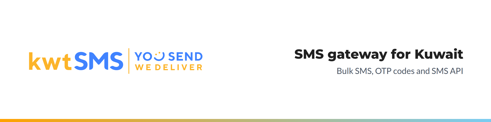
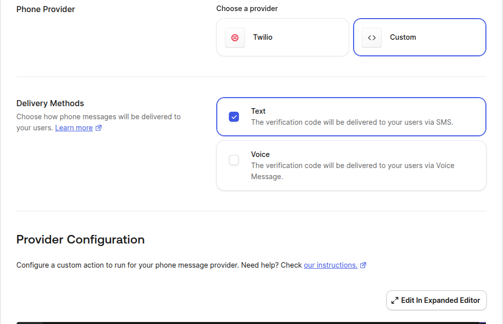
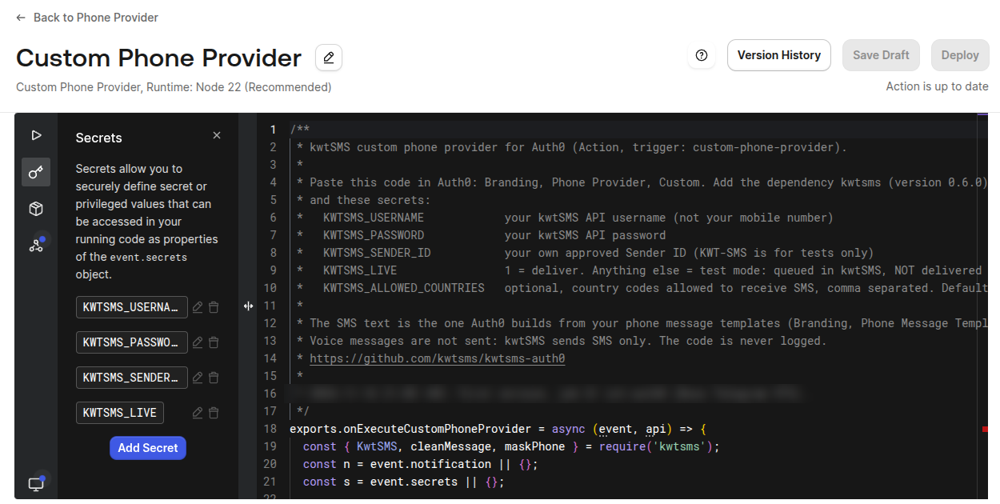
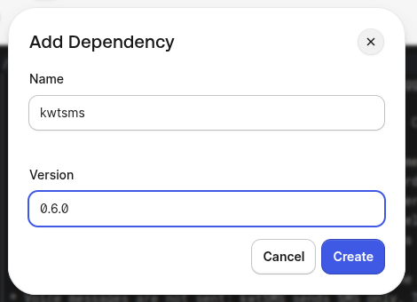
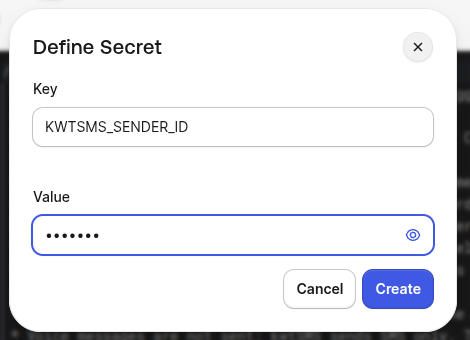
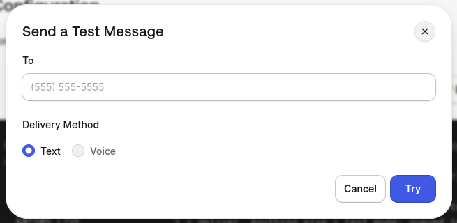
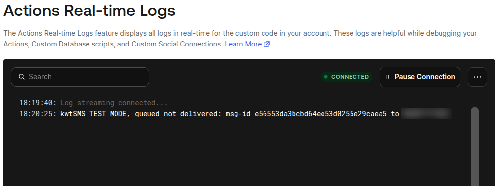

<picture>
  <source media="(prefers-color-scheme: dark)" srcset=".github/assets/readme-header-dark.png">
  
</picture>

# kwtSMS for Auth0

Send your Auth0 SMS (sign-up and login verification codes, MFA codes, blocked account and password notices) through your own kwtSMS account and Sender ID. It is one Auth0 Action for the **custom phone provider**: paste it, add one dependency and your secrets, and Auth0 sends every SMS through kwtSMS.

## About kwtSMS

kwtSMS is a Kuwaiti SMS gateway trusted by top businesses to deliver messages anywhere in the world, with private Sender ID, free API testing, non-expiring credits, and competitive flat-rate pricing. Secure, simple to integrate, built to last. Open a free account in under 1 minute, no paperwork or payment required. [Click here to get started](https://www.kwtsms.com/cportal/signup/)

## What you need

- An Auth0 tenant whose plan includes the custom phone provider (Branding, Phone Provider, Custom).
- A kwtSMS account with the API on: your API username and API password (in your kwtSMS account, API Integration). They are not your mobile number.
- For live delivery: your own approved Sender ID. `KWT-SMS` is for tests only.

## Step by step

### 1. Choose the custom phone provider

In the Auth0 Dashboard open **Branding, Phone Provider**. Choose **Custom** and keep **Text** as the delivery method (kwtSMS sends SMS, not voice calls).

### 2. Paste the Action

Click **Edit In Expanded Editor**, select all the sample code and replace it with the code in [`src/action.js`](src/action.js).

### 3. Add the dependency

Open **Dependencies** (the box icon), click **Add Dependency**, enter `kwtsms` and version `0.6.0`, then **Create**.

### 4. Add the secrets

Open **Secrets** (the key icon) and add each one with **Add Secret**:

| Key | Value |
| --- | --- |
| `KWTSMS_USERNAME` | Your kwtSMS API username |
| `KWTSMS_PASSWORD` | Your kwtSMS API password |
| `KWTSMS_SENDER_ID` | Your own approved Sender ID (`KWT-SMS` for tests) |
| `KWTSMS_LIVE` | `0` while you test, `1` to deliver |
| `KWTSMS_ALLOWED_COUNTRIES` | Optional. Country codes that may receive SMS, comma separated. Default `965` (Kuwait) |

Click **Deploy**, then **Back to Phone Provider** and **Save** (confirm the dialog).

### 5. Test

Click **Send Test Message**, enter your own number with the country code (for example `+965XXXXXXXX`), keep **Text** and click **Try**.

With `KWTSMS_LIVE` set to `0`, kwtSMS accepts and queues the message but does not deliver it. To see the result, open **Monitoring, Actions Real-time Logs** before you click **Try**: the Action logs the kwtSMS msg-id and a masked number.

Then open the Sending Queue in your kwtSMS account, check the number and the text, and delete the test message: test credits are held until you delete it.

### 6. Go live

Make sure your Sender ID is approved, set `KWTSMS_SENDER_ID` to it and `KWTSMS_LIVE` to `1`, deploy, and send one test message to your own number. It now reaches the phone and uses credits.

## What it sends

The text Auth0 builds from your phone message templates (**Branding, Phone Message Templates**), so you edit the wording, Arabic included, in Auth0. Emoji and hidden characters are removed before sending, because they would make the SMS longer and cost more.

## When something goes wrong

| Case | What the Action does |
| --- | --- |
| Voice delivery requested | Drops it: kwtSMS sends SMS only |
| Number outside `KWTSMS_ALLOWED_COUNTRIES` | Drops it, nothing is sent |
| Missing `KWTSMS_USERNAME` or `KWTSMS_PASSWORD` | Drops it with that reason |
| kwtSMS answers with an `ERR` code (wrong password, Sender ID not approved, no balance...) | Drops it with the code, so Auth0 does not repeat a send that would fail again |
| kwtSMS cannot be reached | Asks Auth0 to retry (Auth0 retries up to 5 times) |

Dropped messages appear in the Auth0 tenant logs with the reason. Look up `ERR` codes in the [kwtSMS API documentation](https://www.kwtsms.com/api-documentation.html). The code and the full number are never logged.

## FAQ

**Can I send to numbers outside Kuwait?** Yes. Add the country codes to `KWTSMS_ALLOWED_COUNTRIES` (for example `965,971`) and add those countries to your kwtSMS account coverage.

**Can the SMS be in Arabic?** Yes. Write the Arabic text in Auth0's phone message templates.

**What does it cost?** This Action is free and open source (MIT). Each SMS uses kwtSMS credits like any other message.

## Support

- https://www.kwtsms.com/support.html
- https://www.kwtsms.com/api-documentation.html

## License

MIT, see [LICENSE](LICENSE).
